# Transit watch redesign prototype

Native PebbleOS prototype for Pebble Time 2 (`emery`), adapted from Transit's
[official Apple Watch interface](https://help.transitapp.com/article/210-use-transit-on-apple-watch).
The [audit and compact design specification](design.md) describe the retained
architecture and presentation changes. All screenshots below are actual
200 × 228 Emery emulator captures of this branch's production native binary.
Transit data shown here is synthetic test fixture data, not a live service feed.

## Primary screens

| Nearby routes | Route details / three departures | Stop timeline |
| --- | --- | --- |
| 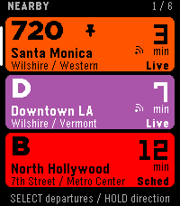 | 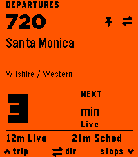 | 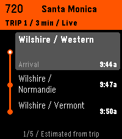 |

| Scrolled list | Second departure selected | Other direction |
| --- | --- | --- |
| 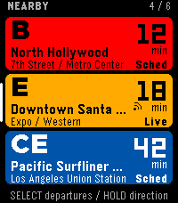 | 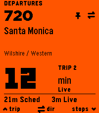 | 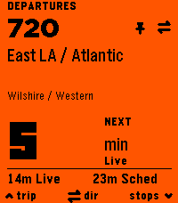 |

| Selected stop | Long route / 99 minutes | Wrapped destination |
| --- | --- | --- |
| 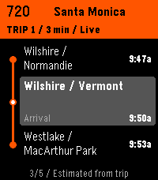 | 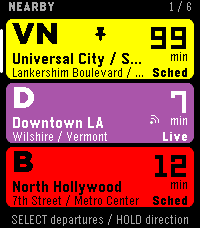 | 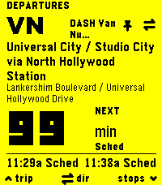 |

| Long stop names | No departures | Loading |
| --- | --- | --- |
| 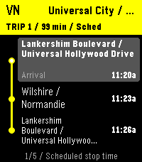 | 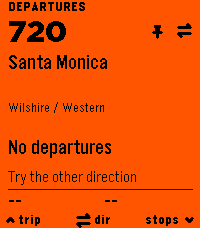 | 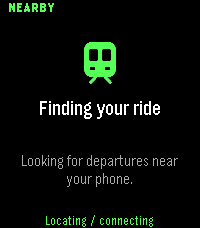 |

## Empty and degraded states

| No nearby routes | Missing key | Location unavailable |
| --- | --- | --- |
| 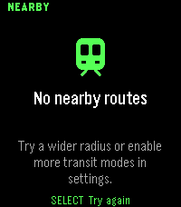 | 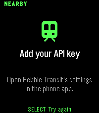 | 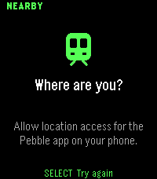 |

| Network error | Saved predictions | Phone not responding |
| --- | --- | --- |
| 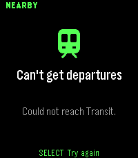 | 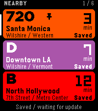 | 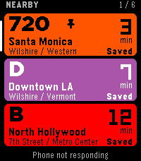 |

The last capture exercises native outbox failure with a rejected watch request,
in addition to QEMU's disconnected Bluetooth flag. QEMU keeps its developer
serial transport alive after that flag changes, so this is not a physical radio
disconnection test.

## Controls

| Screen | Up | Select | Down | Hold Select | Hold Up | Back |
| --- | --- | --- | --- | --- | --- | --- |
| Nearby | Previous route | Departure board | Next route | Other direction | Pin/unpin | Exit |
| Board | Next departure | Other direction | Trip stops | Other direction | Pin/unpin | Nearby |
| Stops | Previous stop | Next departure | Next stop | — | — | Board |

No long press is needed for primary navigation. The stop viewport follows the
selected stop; the selected row expands to reveal its arrival time and name.

## Validation results

Validated October 20, 2026 using the existing repository toolchain:

| Check | Result |
| --- | --- |
| `./scripts/build.sh` | PASS; version 1.8.0, Emery only |
| PBW archive and platform metadata | PASS; 113,449-byte package |
| Native resources | 4,361 bytes / 256 KB |
| Native RAM footprint | 15,592 bytes / 128 KB; 115,480 bytes free heap before runtime allocations |
| `node test/transit.test.js` | PASS; existing data suite, plus prediction provenance assertions |
| `node test/companion.test.js` | PASS; 19 integration tests |
| Host C presentation tests | PASS with `-Wall -Wextra -Werror` |
| Emery native install and button flow | PASS on firmware 4.33.2, SDK 4.33.1 |
| Animation-disabled build and full native flow | PASS |
| PNG capture validation | PASS; 18 actual 200 × 228 screenshots |
| `git diff --check` | PASS |

The companion tests execute the actual JavaScript, intercepting only phone APIs.
They cover continuous viewport navigation without network calls, direction and
departure changes, lazy trip retrieval/cache reuse, cross-route request budgets,
late-response protection, transport serialization, existing preferences and
configuration, no-departure routes, long names, HTTP errors, and per-direction
freshness. The native C tests cover ETA boundaries, nearest-palette colors,
contrast fallback, stale/future timestamps, and safe UTF-8 truncation.

The emulator runner drives real native button events and verifies their outgoing
messages against the actual companion. It checks scrolling, opening the board,
changing direction, selecting departures, loading stops, moving between stops,
cycling trips, Back hierarchy, long-press direction, and pin/unpin. Both normal
and animation-disabled builds pass the same flow.

## Install and reproduce

```sh
./scripts/build.sh
./scripts/emulator.sh
```

The installable production artifact is `build/pebble-transit.pbw` (ignored build
output, not committed). For a physical Pebble Time 2, enable Dev Connect in the
phone app and install using the endpoint/address it provides:

```sh
pebble install --phone PHONE_IP build/pebble-transit.pbw
```

Enter a Transit API key in the existing phone settings page, or use the existing
`TRANSIT_API_KEY` build option described in the root README. Existing saved
credentials, radius, modes, and favorites remain compatible. No real credential
is needed for the fixture checks:

```sh
./.tools/uv-tools/pebble-tool/bin/python scripts/prototype-emulator.py
```

The runner uses a temporary flash image and unused local port, preserving other
running emulators. `--output /tmp/transit-screenshots` keeps captures outside the
repository. `--sdk-root` supports another installed SDK location. All fixtures
live under `test/support/` and are excluded from the production JS bundle by the
existing `wscript` source patterns.

## Preserved integration

- Same Transit v4 endpoints, authentication, location discovery, filters, radius,
  API parameters, settings URL, storage keys, UUID, and Emery-only target.
- Same next-three departures, direction selection, nearby stops, five downstream
  stops, favorites, route/trip caching, and once-per-minute live refresh cadence.
- No API requests for scrolling, switching direction, pinning, or cycling board
  departures. Opening a timeline may fetch uncached trip details. The existing
  five-minute trip cache and weekly mode catalog refresh remain.
- Existing message key numbers 0–72 are retained. New keys 73–79 carry timeline
  requests, continuous viewport position, freshness, and stop-time provenance.
- Empty schedules remain browsable so the no-departure UI can be shown.
- Finite selection transitions replace the former perpetual 80 ms redraw loop.

## Remaining limits

- Physical-watch installation, actual Bluetooth loss/reconnect, and a paid/live
  Transit API request were not exercised. API behavior was validated with realistic
  v4 fixtures; the existing credential and request pipeline remains in place.
- The SDK emits its standard linker warning about an RWX load segment. Native
  source compilation has no warnings in the normal or animation-disabled build.
- Compact nearby rows intentionally ellipsize long names. The board wraps the
  destination and the selected timeline row has more room; extreme strings can
  still exceed a 200-pixel display and are truncated safely.
- The existing five-stop limit and up-to-sixteen nearby routes remain. Favorites
  re-sort on the next nearby refresh, preserving the original behavior.
- Cached routes are persisted by the phone companion. They remain visible in
  watch memory during a temporary disconnect; a cold launch without the phone
  cannot restore that phone cache until the companion reconnects.
- The repository's pre-existing `.tools` symlink requires the shared local Pebble
  toolchain. Other machines need an equivalent SDK setup.
